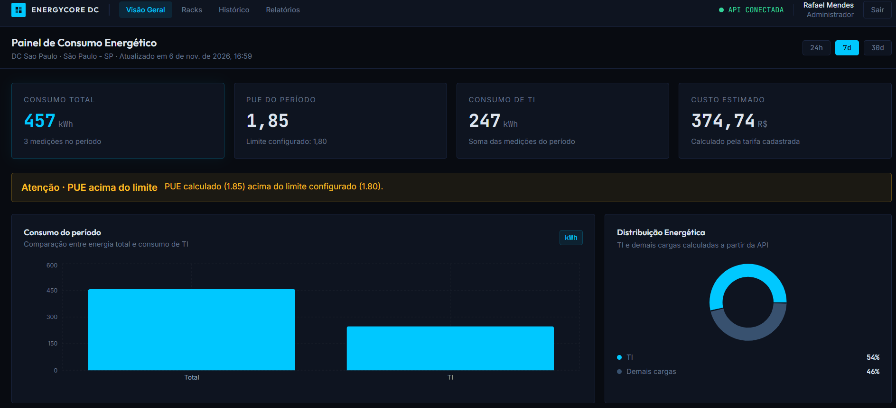

<div align="center">


# Factory Insight

### Plataforma de monitoramento e análise de indicadores industriais

**Projeto Integrador · Superior de Tecnologia em Análise e Desenvolvimento de Sistemas**

**Escola SENAI "Armando de Arruda Pereira"**

**Módulo documentado neste repositório: EnergiaDC**

</div>

---

## Apresentação

O **Factory Insight** é um projeto acadêmico desenvolvido no contexto do Projeto Integrador do curso Superior de Tecnologia em Análise e Desenvolvimento de Sistemas. Seu propósito é organizar e apresentar indicadores relacionados a processos industriais por meio de uma aplicação web.

Este repositório documenta o módulo **EnergiaDC**, dedicado ao monitoramento e à análise de indicadores de consumo energético de um datacenter. A aplicação reúne uma interface web, uma API REST e um banco de dados relacional para transformar registros de consumo em informações visuais e indicadores de apoio à análise.

> **Escopo:** este repositório apresenta o módulo EnergiaDC dentro do projeto maior Factory Insight. As funcionalidades descritas refletem a versão acadêmica disponível e as validações registradas pela equipe.

## Equipe do projeto

| Integrante |
|---|
| Marlon Carvalho de Farias |
| Leonardo da Silva |
| Pedro Henrique Gomes dos Santos |
| Victor de Freitas Queijo |
| Patrick Romano Silva |
| Lucas Siqueira Apolinário |

**Instituição:** Escola SENAI "Armando de Arruda Pereira"  
**Curso:** Superior de Tecnologia em Análise e Desenvolvimento de Sistemas  
**Projeto:** Projeto Integrador — Factory Insight

## Visão geral da aplicação

O módulo EnergiaDC apresenta:

- Indicadores de consumo total e consumo de TI;
- Cálculo do índice PUE (*Power Usage Effectiveness*);
- Estimativa de custo energético;
- Seleção de período para consulta;
- Gráficos para comparação e distribuição do consumo;
- Aviso quando o PUE ultrapassa o limite configurado;
- Indicador visual do estado da conexão com a API.

### Dashboard



*Captura de evidência da integração registrada em 06/11/2026. Os valores exibidos correspondem à consulta validada naquele momento.*

## Arquitetura da solução

```text
Usuário
   |
   v
Frontend (React + Vite)
   |
   | Requisição HTTP / JSON
   v
Backend (Java + Spring Boot)
   |
   | Spring Data JPA
   v
Banco relacional (PostgreSQL / Amazon RDS)
```

Na execução local, o backend também pode utilizar H2 para demonstração. As configurações de conexão são realizadas por variáveis de ambiente.

## Tecnologias utilizadas

| Camada | Tecnologias |
|---|---|
| Frontend | React, Vite, Recharts |
| Backend | Java 21, Spring Boot, Spring Web |
| Persistência | Spring Data JPA / Hibernate |
| Banco de dados | PostgreSQL (Amazon RDS) e H2 para execução local |
| Documentação da API | Springdoc / OpenAPI / Swagger UI |
| Versionamento | Git e GitHub |

## Estrutura do repositório

```text
factory-insight/
├── backend/
│   ├── src/
│   └── pom.xml
├── frontend/
│   ├── src/
│   ├── public/
│   └── package.json
├── database/
│   └── schema.sql
├── docs/
│   ├── modelo-de-classes.md
│   ├── relatorio-tecnico.md
│   └── apresentacao-institucional.md
├── evidencias/
└── README.md
```

## Funcionalidades e API

### Consulta do resumo energético

`GET /api/datacenters/{datacenter_id}/energy-summary`

Parâmetros:
- `start`: início do período em formato ISO 8601;
- `end`: fim do período em formato ISO 8601.

O endpoint retorna informações do datacenter, período consultado, quantidade de medições, consumo total, consumo de TI, PUE, limite configurado, custo estimado e possível alerta.

### Verificação de saúde

`GET /health`

Verifica se a API está respondendo.

### Documentação interativa

Com o backend em execução, a documentação Swagger UI fica disponível em `/docs` e a especificação OpenAPI em `/openapi.json`.

## Indicadores calculados

- **PUE:** consumo total dividido pelo consumo de TI.
- **Custo estimado:** consumo total em kWh multiplicado pela tarifa cadastrada em R$/kWh.
- **Alerta de PUE:** retornado quando o PUE calculado ultrapassa o limite configurado para o datacenter.

## Evidências de validação

A pasta [`evidencias/`](evidencias/) reúne registros e capturas de validação. Entre eles:

- `validacao_java_rds.txt`: registro da consulta realizada pela API Java ao PostgreSQL no Amazon RDS;
- `validacao_integracao_front_back.txt`: registro da tela React consumindo a API Java;
- `dashboard_integrado_java_rds.png`: captura do dashboard com o estado de API conectada;
- `api_java_rds_resposta.png`: captura da resposta da API Java.

Há também arquivos identificados como históricos da versão Python anterior. Eles foram mantidos como referência e **não devem ser confundidos com a validação da versão Java atual**.

## Como executar localmente

### Pré-requisitos

- JDK 21;
- Maven;
- Node.js compatível com a versão do Vite utilizada;
- Corepack / pnpm.

### 1. Backend

No terminal, entre na pasta `backend`:

```powershell
cd backend
```

Configure as variáveis de ambiente necessárias para sua execução local. Para iniciar:

```powershell
mvn spring-boot:run
```

A API ficará disponível em `http://localhost:8000`.

### 2. Frontend

Em outro terminal, entre na pasta `frontend`:

```powershell
cd frontend
corepack pnpm install
corepack pnpm dev
```

Abra o endereço local informado pelo Vite no terminal. A configuração de exemplo aponta para a API em `http://127.0.0.1:8000`.

### 3. Conexão com Amazon RDS

Para utilizar um banco remoto, configure as variáveis de conexão exigidas pela aplicação no ambiente em que o backend será iniciado. Não coloque senhas, certificados ou arquivos `.env` reais no GitHub.

As configurações de rede e acesso ao RDS devem permitir a conexão somente a partir das origens autorizadas.

## Observações sobre o escopo acadêmico atual

- O login presente no frontend é uma simulação local; não representa autenticação validada pelo backend.
- A API disponibiliza um resumo agregado por período. Portanto, os gráficos atuais representam os totais retornados pela API, e não uma série histórica detalhada por hora.
- A interface contém opções de navegação visual, mas as telas de Racks, Histórico e Relatórios não devem ser consideradas módulos funcionais completos nesta versão.
- A evidência de integração com RDS registra um teste realizado em 06/11/2026. Ela não garante que a infraestrutura esteja disponível continuamente.
- Este é um protótipo acadêmico em desenvolvimento. As funcionalidades e etapas futuras não são apresentadas como concluídas.

## Documentação complementar

- [Apresentação institucional e identificação acadêmica](docs/apresentacao-institucional.md)
- [Relatório técnico do backend](docs/relatorio-tecnico.md)
- [Modelo de classes](docs/modelo-de-classes.md)
- [Script de criação do banco](database/schema.sql)
- [Evidências de validação](evidencias/LEIA-ME.txt)

## Identidade institucional

Este trabalho foi desenvolvido no âmbito acadêmico da **Escola SENAI "Armando de Arruda Pereira"**. A marca SENAI-SP segue o [Manual de Identidade Visual da instituição](https://www.sp.senai.br/noticia/manual-de-identidade-visual).

---

<div align="center">

**Factory Insight · Módulo EnergiaDC**

Projeto Integrador — Superior de Tecnologia em Análise e Desenvolvimento de Sistemas  
Escola SENAI "Armando de Arruda Pereira"

</div>
