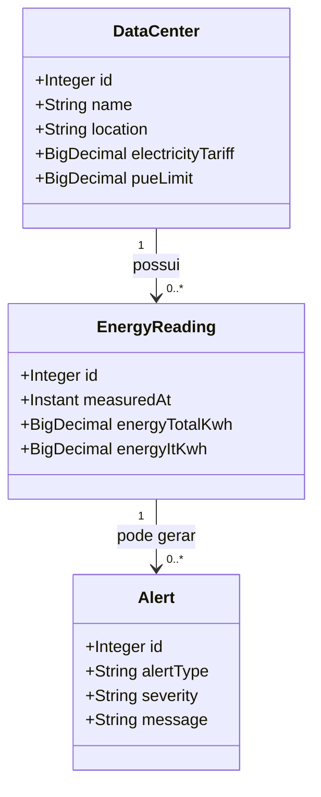

# Relatório técnico — EnergiaDC (backend Java)

## 1. Objetivo

O EnergiaDC fornece uma API REST para consultar medições de energia de datacenters. A aplicação acessa um banco relacional e calcula indicadores para um intervalo informado.

## 2. Tecnologias e arquitetura

- Java 21 e Spring Boot 3.5.
- Spring Web para as rotas REST e Spring Data JPA/Hibernate para persistência.
- PostgreSQL no Amazon RDS para ambiente remoto e H2 para demonstração local.
- Swagger UI/OpenAPI para documentação interativa.

A aplicação está organizada em controllers, services, repositories, models e DTOs. As credenciais são carregadas de `.env` e não devem ser incluídas em ZIPs públicos.

## 3. Modelo de classes

`DataCenter` guarda identificação, localização, tarifa e limite de PUE. `EnergyReading` registra os consumos total e de TI em um instante, vinculado a um datacenter. `Alert` registra um aviso relacionado a uma medição.

## 4. Regras de negócio

1. Os valores de consumo total e de TI devem ser positivos; o total deve ser maior ou igual ao consumo de TI.
2. Um datacenter não pode ter duas medições no mesmo instante.
3. `PUE = soma do consumo total / soma do consumo de TI`.
4. `Custo estimado = energia total em kWh × tarifa em R$/kWh`.
5. A resposta inclui alerta `PUE_ABOVE_LIMIT` quando o PUE calculado ultrapassa o limite configurado.
6. Início e fim do intervalo devem estar em ISO 8601 com fuso horário, e o início deve ser anterior ao fim.

## 5. API

`GET /api/datacenters/{datacenter_id}/energy-summary?start=<ISO-8601>&end=<ISO-8601>` retorna o datacenter, período UTC, quantidade de medições, consumo total e de TI, PUE, limite, custo estimado e alerta.

`GET /health` retorna status da aplicação. A documentação interativa está em `/docs` e a especificação em `/openapi.json`.

## 6. Banco de dados e execução

Em desenvolvimento local, o projeto usa H2 e carrega dados demonstrativos apenas se a tabela de datacenters estiver vazia. Para o RDS, configure `DB_URL`, `DB_USERNAME`, `DB_PASSWORD` e `DDL_AUTO=validate` em `.env`, além do certificado CA global. O endpoint usa SSL validado e a porta TCP 5432 deve estar liberada no security group somente para o IP autorizado.

Em 06/11/2026, a versão Java/Spring Boot foi iniciada conectada ao Amazon RDS PostgreSQL 18.3 e validada pelo endpoint `GET /api/datacenters/1/energy-summary`. A resposta leu três medições do datacenter `DC Sao Paulo`: 457 kWh totais, 247 kWh de TI, PUE 1,85, custo estimado de R$ 374,74 e alerta `PUE_ABOVE_LIMIT` com severidade `warning`, acima do limite configurado de 1,80. O registro e a captura estão em `evidencias/validacao_java_rds.txt` e `evidencias/api_java_rds_resposta.png`. As evidências sem o prefixo `api_java` documentam somente a versão Python original.

## 7. Validação do front-end integrado

Em 06/11/2026, o painel React/Vite foi iniciado em `http://localhost:8443` enquanto a API Java estava ativa na porta 8000. A tela confirmou `API CONECTADA` e apresentou os dados vindos do endpoint do RDS: três medições, consumo total de 457 kWh, consumo de TI de 247 kWh, PUE 1,85, custo estimado de R$ 374,74 e alerta acima do limite. A captura e o registro estão na pasta `evidencias/`.
